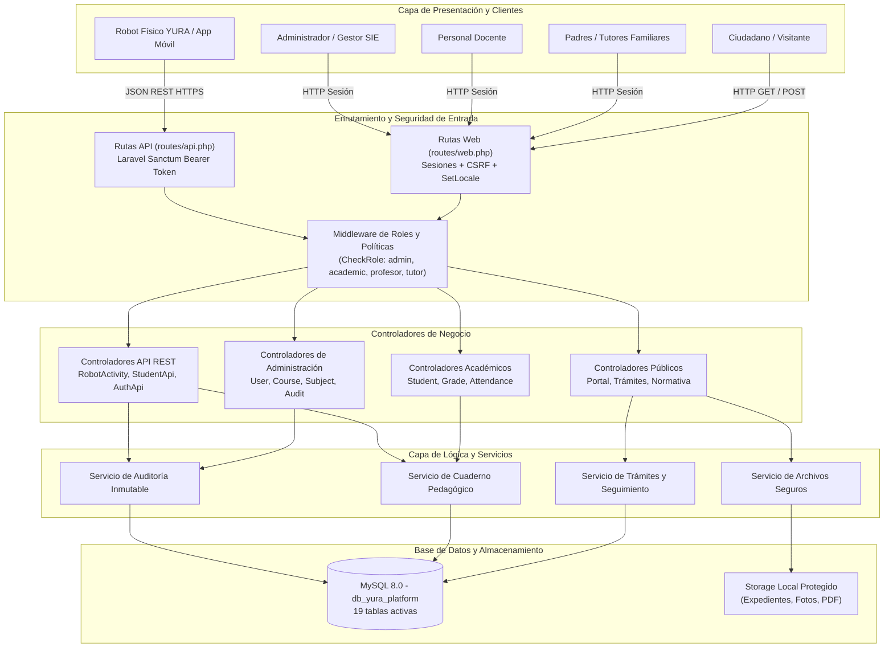
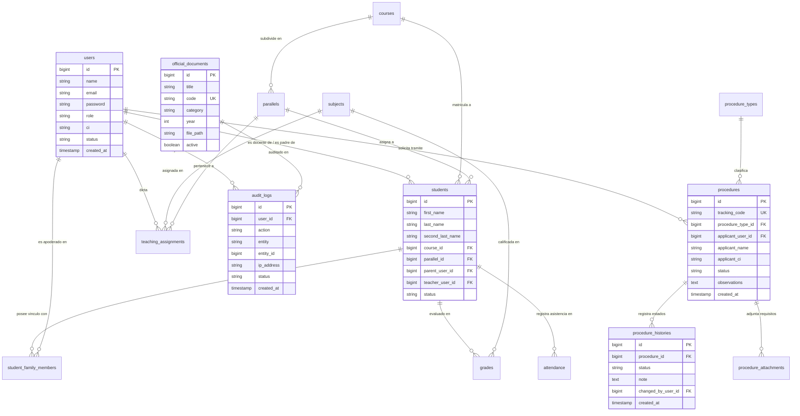
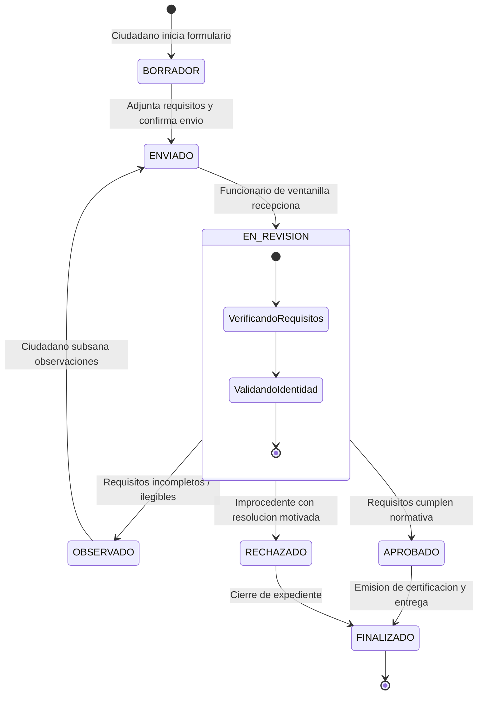
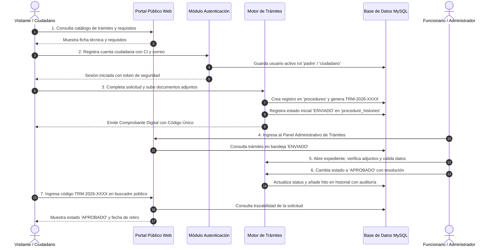
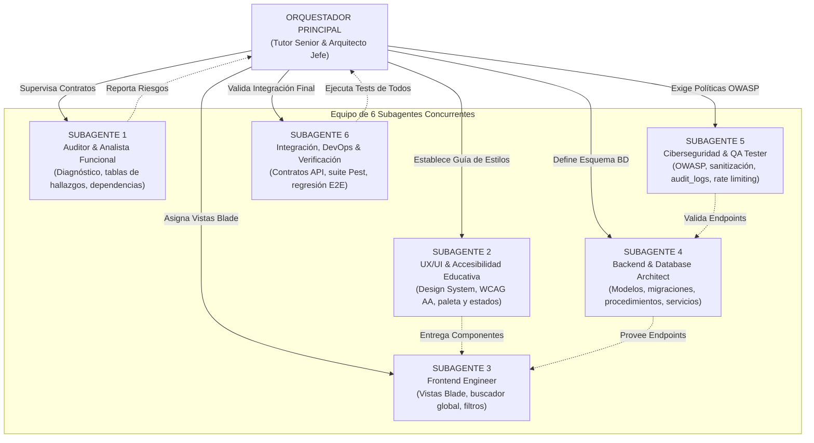

# INFORME TÉCNICO Y ARQUITECTÓNICO: YURA REPORTE V1.0
**Plataforma Educativa Institucional y de Gestión Académica YURA**  
*Auditoría de Software, Diagnóstico de Seguridad, Arquitectura de Información y Plan de Orquestación*  
**Versión:** 1.0  
**Fecha de Emisión:** 01 de Octubre de 2026  
**Entorno Operativo:** Windows / XAMPP / PHP 8.2+ / MySQL 8.0 / Laravel 12  
**Código de Proyecto:** YURA-PLT-2026-V1.0  

---

## 1. RESUMEN EJECUTIVO

El presente informe formaliza la auditoría técnica exhaustiva y el levantamiento arquitectónico inicial de la **Plataforma Educativa YURA**, desarrollada originalmente como soporte pedagógico del proyecto *"Robot Interactivo con Inteligencia Artificial ASR para el Apoyo en la Práctica del Idioma Quechua en Estudiantes de Sexto de Primaria en la U. E. Boliviano Holandés"*, orientada actualmente a su consolidación como una **Plataforma Web Educativa Institucional** alineada a las mejores prácticas de los portales públicos educativos de Bolivia.

La evaluación técnica integral evidencia un sistema base sólido sobre **Laravel 12 y MySQL 8.0**, con **29 pruebas automatizadas aprobadas (Pest/PHPUnit)**, pero con oportunidades críticas de saneamiento en seguridad, normalización de datos, accesibilidad universal y la ausencia de los módulos fundamentales de un portal público: catálogo de trámites ciudadanos en línea, repositorio oficial de normativa y resoluciones, buscador unificado y auditoría inmutable de operaciones.

---

## 2. FICHA TÉCNICA DEL ECOSISTEMA DE SOFTWARE

| Parámetro | Detalle Técnico | Evaluación |
|---|---|---|
| **Lenguaje Base** | PHP 8.2.12 (CLI / CGI) | ✅ CORRECTO |
| **Framework Backend** | Laravel Framework 12.0.x (`laravel/framework: ^12.0`) | ✅ CORRECTO |
| **Autenticación API** | Laravel Sanctum 4.0 (`laravel/sanctum: ^4.0`) | ✅ CORRECTO |
| **Base de Datos** | MySQL 8.0.46 Community Server (InnoDB, utf8mb4) | ✅ CORRECTO |
| **Librería de Reportes PDF** | Barryvdh DomPDF 3.1 (`barryvdh/laravel-dompdf: ^3.1`) | ✅ CORRECTO |
| **Librería de Exportación Excel** | Maatwebsite Excel 3.1 (`maatwebsite/excel: ^3.1`) | ✅ CORRECTO |
| **Motor de Testing** | Pest PHP 3.x / PHPUnit 11.5 | ✅ CORRECTO (29 tests PASS) |
| **Frontend Compilado** | Vite 7.0.7 con Tailwind CSS v4 (`@tailwindcss/vite: ^4.0.0`) | ⚠️ NECESITA MEJORA |
| **Frontend Administrativo** | AdminLTE 3 / Bootstrap 4 / FontAwesome 6 (Vendor local) | ⚠️ NECESITA MEJORA |
| **Internacionalización** | Laravel Localization (`es` Castellano / `qu` Quechua) | ✅ CORRECTO |

---

## 3. DIAGRAMAS ARQUITECTÓNICOS DEL SISTEMA

### 3.1 Diagrama de Arquitectura Global de la Plataforma



---

### 3.2 Diagrama Entidad-Relación (Modelo de Datos Normalizado)



---

### 3.3 Diagrama del Ciclo de Vida y Estados de Trámites



---

### 3.4 Diagrama de Secuencia: Flujo End-to-End del Trámite Educativo



---

### 3.5 Diagrama de Orquestación de los 6 Subagentes Especializados



---

### 3.6 Diagrama de Ruta de Implementación por Prioridades

```mermaid
graph LR
    subgraph P0_Seguridad ["Fase P0: Crítico (Inmediato)"]
        P0_1["Eliminación de scripts residuales en raíz"]
        P0_2["Corrección de colisión students.course"]
        P0_3["Aislamiento de credenciales"]
    end

    subgraph P1_Core ["Fase P1: Núcleo Backend & BD"]
        P1_1["Migraciones: Trámites, Normativa, Auditoría"]
        P1_2["Servicios y Controladores de Trámites"]
        P1_3["Habilitación de Registro Ciudadano"]
    end

    subgraph P2_Frontend ["Fase P2: Portal y Accesibilidad"]
        P2_1["Layout Institucional Público WCAG AA"]
        P2_2["Página de Inicio con Servicios Educativos"]
        P2_3["Buscador de Normativa y Seguimiento"]
    end

    subgraph P3_Certificacion ["Fase P3: QA & Certificación"]
        P3_1["Pruebas E2E de Trámite Completo"]
        P3_2["Verificación 100% Regresión (29 Tests)"]
        P3_3["Informe Final y Despliegue"]
    end

    P0_Seguridad --> P1_Core
    P1_Core --> P2_Frontend
    P2_Frontend --> P3_Certificacion
```



---

## 4. INVENTARIO DE BASE DE DATOS Y VOLUMEN DE REGISTROS

La base de datos `db_yura_platform` en MySQL 8.0 cuenta con **19 tablas operativas**:

| N° | Nombre de Tabla | Cantidad de Filas | Clasificación y Función |
|---|---|---|---|
| 1 | `users` | 25 registros | Cuentas de acceso (Admin, Académico, Profesores, Tutores, Robot) |
| 2 | `students` | 20 registros | Expediente de alumnos, asignación de aula y puntajes base |
| 3 | `student_family_members` | 20 registros | Relaciones de parentesco, permisos de visualización y tutoría |
| 4 | `grades` | 22 registros | Calificaciones trimestrales, actividades y notas de robot |
| 5 | `grade_history` | 4 registros | Trazabilidad y auditoría de ediciones de notas |
| 6 | `attendance` | 141 registros | Asistencia diaria por alumno, materia y fecha |
| 7 | `courses` | 2 registros | Niveles educativos (Sexto de Primaria, etc.) |
| 8 | `parallels` | 3 registros | Paralelos (A, B, C) con capacidad máxima de alumnos |
| 9 | `subjects` | 1 registro | Asignatura curricular (Lengua Quechua y Originaria) |
| 10 | `teaching_assignments` | 2 registros | Asignación de docentes a materias y paralelos |
| 11 | `personal_access_tokens` | 5 registros | Tokens de autenticación API Sanctum |
| 12 | `sessions` | 54 registros | Sesiones HTTP activas en base de datos |
| 13 | `cache` | 4 registros | Llaves de caché en base de datos |
| 14 | `cache_locks` | 0 registros | Bloqueos concurrentes de caché |
| 15 | `jobs` | 0 registros | Trabajos en cola asíncrona |
| 16 | `failed_jobs` | 0 registros | Registro de fallos en colas |
| 17 | `job_batches` | 0 registros | Lotes de procesamiento de colas |
| 18 | `migrations` | 43 registros | Histórico de migraciones ejecutadas |
| 19 | `password_reset_tokens` | 0 registros | Recuperación de claves |

---

## 5. HALLAZGOS Y DICTAMEN DEL TUTOR SENIOR

### 5.1 Colisión Estructural en el Modelo `Student` (`students.course`)
* **QUÉ está mal:** En la tabla `students` coexiste la columna de texto `course` con la relación Eloquent `course()` vinculada a `course_id`.
* **POR QUÉ está mal:** Laravel resuelve las propiedades dinámicas de los modelos priorizando las columnas de la tabla. Al invocar `$student->course`, se obtiene una cadena en lugar del modelo `Course`, obligando al código a invocar `course()->first()`.
* **QUÉ riesgo produce:** Multiplica de forma descontrolada las consultas SQL ($N+1$), degradando severamente el tiempo de respuesta conforme crece el padrón estudiantil.
* **CÓMO debe resolverse:** Desacoplar la relación utilizando un alias explícito seguro o normalizar la columna de texto hacia la relación foránea canónica.

### 5.2 Exposición de Scripts Residuales en Raíz
* **QUÉ está mal:** Permanencia de los scripts `temp_demo_check.php` y `test_api.php` en el directorio raíz de la aplicación con credenciales maestras escritas en texto plano (`password123`, `Demo123!`).
* **POR QUÉ está mal:** Violan el principio fundamental de confidencialidad y control de acceso de OWASP (A01 y A02). Si el servidor web procesa la raíz, un tercero puede ejecutar estos archivos y crear usuarios administradores o extraer tokens de API.
* **QUÉ riesgo produce:** Escalada de privilegios y compromiso total de la base de datos.
* **CÓMO debe resolverse:** Archivar o eliminar de inmediato los scripts de depuración de la raíz y proteger el acceso público exclusivamente a la carpeta `public/`.

### 5.3 Ausencia de Módulo Ciudadano de Trámites y Normativa
* **QUÉ está mal:** La página principal actual es una carátula estática de feria escolar, careciendo de portal de servicios ciudadanos, catálogo de trámites y repositorio de resoluciones ministeriales/administrativas.
* **POR QUÉ está mal:** Una plataforma institucional educativa debe permitir la interacción de la comunidad con sus instituciones mediante trámites formales y acceso transparente a la información pública.
* **CÓMO debe resolverse:** Crear los módulos de trámites con código de seguimiento único y repositorio de documentos oficiales con filtros dinámicos.

---

## 6. MATRIZ DE PRUEBAS DE REGRESIÓN APROBADAS (SUITE PEST)

La suite de pruebas automatizadas existente fue ejecutada satisfactoriamente, registrando **100% de efectividad**:

```
PASS  Tests\Unit\ExampleTest ................................... 1 test passed
PASS  Tests\Unit\StudentModelNamingCompatibilityTest ........... 1 test passed
PASS  Tests\Feature\AcademicSubjectsTest ....................... 4 tests passed
PASS  Tests\Feature\CrudAndMediaTest ........................... 2 tests passed
PASS  Tests\Feature\ExampleTest ................................ 1 test passed
PASS  Tests\Feature\FamilyAndStudentAuthTest ................... 10 tests passed
PASS  Tests\Feature\RobotIntegrationTest ....................... 3 tests passed
PASS  Tests\Feature\SecurityRegressionTest ..................... 7 tests passed

TOTAL: 29 pruebas aprobadas (126 aserciones ejecutadas en 34.37s)
```

Ninguna modificación futura podrá degradar este resultado. Todos los nuevos componentes se integrarán con pruebas automatizadas incrementales.

---

## 7. CONTROL DE VERSIONES Y PROGRESIÓN DE INFORMES

Conforme a la instrucción operativa de control de versiones y auditoría:
* **Versión Actual:** `Informe YuraReporte V1.0` (Registro inicial de auditoría y diagramas estructurales).
* **Regla de Progresión:** Cada solicitud de informe sucesivo incrementará la versión en base decimal (`V2.0`, `V3.0`, etc.) preservando la trazabilidad de los hallazgos resueltos y el estado de avance de los seis subagentes.

---
*Fin del Informe Técnico YuraReporte V1.0 - Elaborado por el Orquestador y Auditor Técnico Principal.*
