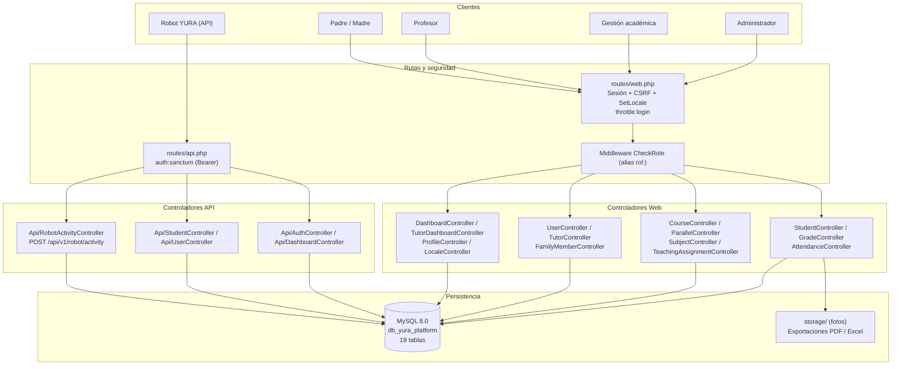
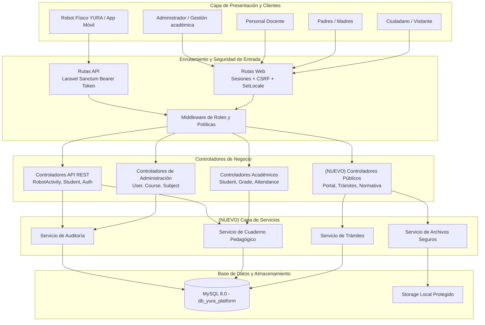
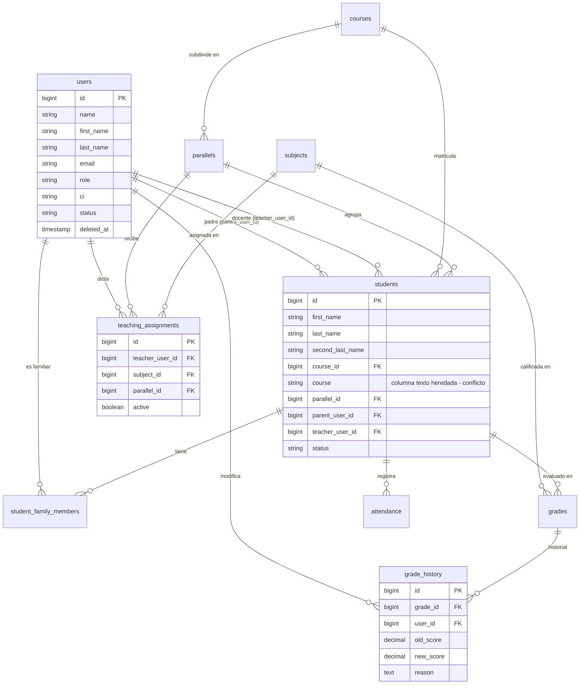
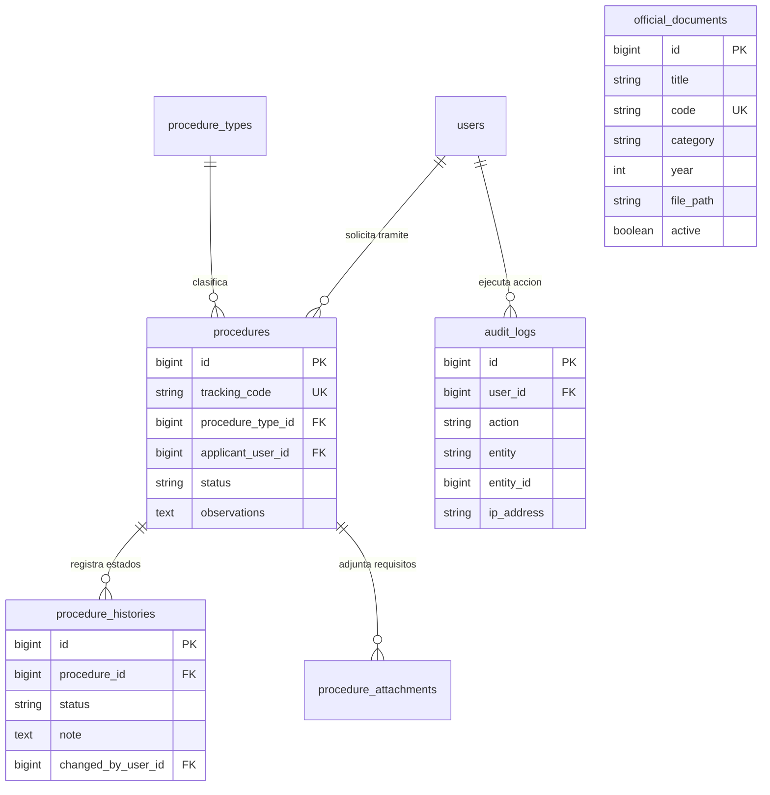
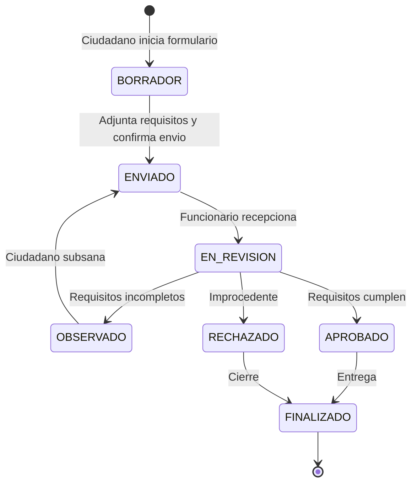
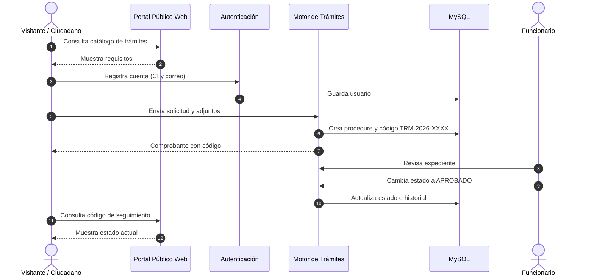
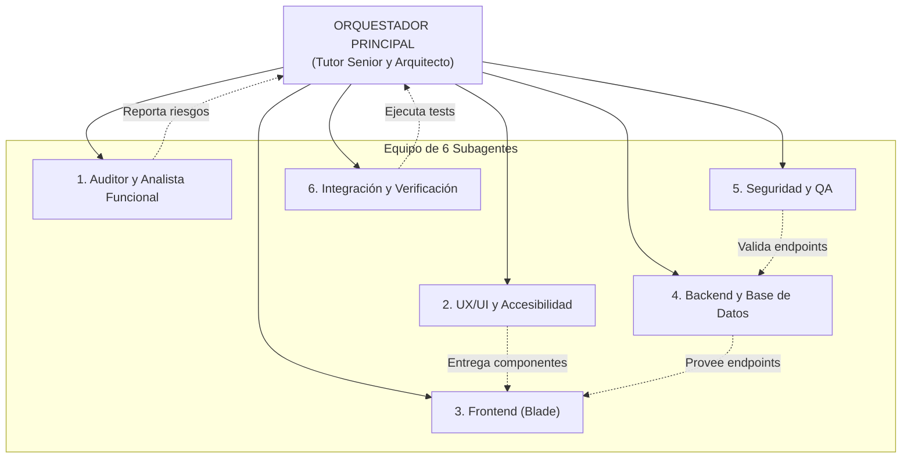

# INFORME TÉCNICO Y ARQUITECTÓNICO: YURA REPORTE V1.1
**Plataforma Educativa Institucional y de Gestión Académica YURA**  
*Auditoría de Software, Diagnóstico de Seguridad, Arquitectura de Información y Plan de Orquestación*  
**Versión:** 1.1 (revisión de V1.0)  
**Fecha de Emisión:** 01 de Octubre de 2026  
**Entorno Operativo:** Windows / XAMPP / PHP 8.2+ / MySQL 8.0 / Laravel 12  
**Código de Proyecto:** YURA-PLT-2026-V1.1  

---

## 0. CAMBIOS RESPECTO A V1.0

| N° | Cambio | Motivo |
|---|---|---|
| 1 | Se separa el **modelo de datos actual** (verificado en BD) del **modelo propuesto**. | V1.0 mezclaba tablas inexistentes (`procedures`, `procedure_histories`, `procedure_types`, `official_documents`, `audit_logs`) con las reales sin indicarlo. |
| 2 | Se agrega el **diagrama de arquitectura actual** y el diagrama de V1.0 pasa a llamarse **arquitectura objetivo (propuesta)**. | Los controladores y servicios `PublicCtrl`, `ProcedureService`, `AuditService`, `MediaService` no existen en el código. |
| 3 | Los diagramas de trámites (ciclo de vida y secuencia) se marcan como **propuesta pendiente de aprobación de alcance**. | El módulo de trámites ciudadanos no existe y no figura en los requisitos del proyecto YURA. |
| 4 | Se corrige el inventario de **roles**. | V1.0 listaba `tutor` como rol activo; en BD no existe ningún usuario con ese rol. |
| 5 | Se eleva la severidad del hallazgo de **scripts en la raíz**. | En XAMPP sin VirtualHost la raíz del proyecto es servida por Apache. |
| 6 | Se corrige la **regla de versionado** a incrementos de 0.1. | Coherente con la serie existente `Corregir Documentacion v1.1 / v1.2 / v1.3`. |

---

## 1. RESUMEN EJECUTIVO

El presente informe formaliza la auditoría técnica y el levantamiento arquitectónico inicial de la **Plataforma Educativa YURA**, desarrollada como soporte pedagógico del proyecto *"Robot Interactivo con Inteligencia Artificial ASR para el Apoyo en la Práctica del Idioma Quechua en Estudiantes de Sexto de Primaria en la U. E. Boliviano Holandés"*.

La evaluación evidencia un sistema base sólido sobre **Laravel 12 y MySQL 8.0**, con **29 pruebas automatizadas aprobadas (126 aserciones, Pest/PHPUnit)**. Se identifican problemas concretos de seguridad (scripts de depuración con credenciales en la raíz y versionados en git), un conflicto de nombres en el modelo `Student` que provoca consultas N+1, y roles declarados en rutas que no existen en los datos.

Los módulos de portal público (trámites, normativa, buscador unificado, auditoría) **no existen actualmente**; en este informe se presentan como **propuesta**, sujeta a confirmar que forman parte del alcance del proyecto.

---

## 2. FICHA TÉCNICA DEL ECOSISTEMA DE SOFTWARE

| Parámetro | Detalle Técnico | Evaluación |
|---|---|---|
| **Lenguaje Base** | PHP 8.2.12 (CLI / CGI) | ✅ CORRECTO |
| **Framework Backend** | Laravel Framework 12.0.x (`laravel/framework: ^12.0`) | ✅ CORRECTO |
| **Autenticación API** | Laravel Sanctum 4.0 (`laravel/sanctum: ^4.0`) | ✅ CORRECTO |
| **Base de Datos** | MySQL 8.0.46 (InnoDB, utf8mb4), BD `db_yura_platform` | ✅ CORRECTO |
| **Librería de Reportes PDF** | barryvdh/laravel-dompdf 3.1 | ✅ CORRECTO |
| **Librería de Exportación Excel** | maatwebsite/excel 3.1 | ✅ CORRECTO |
| **Motor de Testing** | Pest PHP 3.x / PHPUnit 11.5 | ✅ CORRECTO (29 tests PASS) |
| **Frontend Compilado** | Vite 7 con Tailwind CSS v4 | ⚠️ NECESITA MEJORA (convive con AdminLTE) |
| **Frontend Administrativo** | AdminLTE 3 / Bootstrap 4 / FontAwesome (vendor local) | ⚠️ NECESITA MEJORA |
| **Internacionalización** | Archivos `es` (Castellano) y `qu` (Quechua) | ✅ CORRECTO |

---

## 3. DIAGRAMAS ARQUITECTÓNICOS DEL SISTEMA

### 3.1 Diagrama de Arquitectura ACTUAL (verificada en el código)



> Nota: la aplicación no tiene una capa de servicios separada; la lógica de negocio reside en los controladores.

### 3.2 Diagrama de Arquitectura OBJETIVO (propuesta, no implementada)

> ⚠️ **PROPUESTA.** Los componentes `PublicCtrl`, `ProcedureService`, `AuditService` y `MediaService` **no existen** en el código actual. Este diagrama describe el estado objetivo sugerido.



---

### 3.3 Diagrama Entidad-Relación ACTUAL (verificado en BD)



### 3.4 Diagrama Entidad-Relación PROPUESTO (tablas nuevas, no existen)

> ⚠️ **PROPUESTA.** Ninguna de estas tablas existe en `db_yura_platform` ni en `database/migrations`.



---

### 3.5 Ciclo de Vida de Trámites (PROPUESTA — pendiente de aprobar alcance)

> ⚠️ El módulo de trámites ciudadanos **no existe** y no figura en `docs/pruebas/identificacion-requisitos-verificables-yura.md`. Debe confirmarse con el equipo si entra en el alcance antes de implementarlo.



### 3.6 Secuencia End-to-End del Trámite (PROPUESTA)



---

### 3.7 Orquestación de los 6 Subagentes



### 3.8 Ruta de Implementación por Prioridades

```mermaid
graph LR
    subgraph P0 ["P0: Crítico (inmediato)"]
        P0_1["Retirar temp_demo_check.php y test_api.php del repo"]
        P0_2["Resolver colisión students.course"]
        P0_3["Proteger raíz del proyecto (VirtualHost a public/)"]
    end

    subgraph P1 ["P1: Núcleo"]
        P1_1["Depurar roles inexistentes en rutas"]
        P1_2["Unificar guardado de asistencia"]
        P1_3["Módulos nuevos SOLO si se aprueba el alcance"]
    end

    subgraph P2 ["P2: Frontend"]
        P2_1["Unificar AdminLTE / Tailwind"]
        P2_2["Accesibilidad WCAG AA"]
    end

    subgraph P3 ["P3: QA"]
        P3_1["Regresión: 29 tests deben seguir pasando"]
        P3_2["Informe final"]
    end

    P0 --> P1
    P1 --> P2
    P2 --> P3
```



---

## 4. INVENTARIO DE BASE DE DATOS Y VOLUMEN DE REGISTROS

La base de datos `db_yura_platform` (MySQL 8.0) cuenta con **19 tablas**:

| N° | Tabla | Filas | Función |
|---|---|---|---|
| 1 | `users` | 25 | Cuentas de acceso |
| 2 | `students` | 20 | Expediente de alumnos |
| 3 | `student_family_members` | 20 | Vínculos familiares |
| 4 | `grades` | 22 | Calificaciones y actividades del robot |
| 5 | `grade_history` | 4 | Historial de cambios de nota |
| 6 | `attendance` | 141 | Asistencia diaria |
| 7 | `courses` | 2 | Cursos / niveles |
| 8 | `parallels` | 3 | Paralelos |
| 9 | `subjects` | 1 | Asignaturas |
| 10 | `teaching_assignments` | 2 | Docente ↔ materia ↔ paralelo |
| 11 | `personal_access_tokens` | 5 | Tokens Sanctum |
| 12 | `sessions` | 54 | Sesiones web |
| 13 | `cache` | 4 | Caché |
| 14 | `cache_locks` | 0 | Bloqueos de caché |
| 15 | `jobs` | 0 | Cola |
| 16 | `failed_jobs` | 0 | Fallos de cola |
| 17 | `job_batches` | 0 | Lotes de cola |
| 18 | `migrations` | 43 | Migraciones ejecutadas |
| 19 | `password_reset_tokens` | 0 | Recuperación de claves |

### 4.1 Roles: datos vs. rutas

| Rol | Usuarios en BD | Referenciado en `routes/web.php` | Observación |
|---|---|---|---|
| `admin` | 1 | Sí | ✅ |
| `academic` | 1 | Sí | ✅ |
| `profesor` | 2 | Sí | ✅ |
| `padre` | 20 | Sí | ✅ |
| `robot` | 1 | No (solo API) | ✅ Uso exclusivo de la API |
| `tutor` | **0** | Sí | ⚠️ Rol declarado sin usuarios |
| `madre` | **0** | Sí | ⚠️ Rol declarado sin usuarios |
| `estudiante` | **0** | Sí (`students` resource) | ⚠️ Rol declarado sin usuarios |

---

## 5. HALLAZGOS Y DICTAMEN DEL TUTOR SENIOR

### 5.1 Scripts de depuración con credenciales en la raíz — **SEVERIDAD CRÍTICA**
* **QUÉ está mal:** `temp_demo_check.php` (contraseña `Demo123!`) y `test_api.php` (contraseña `password123`) están en la raíz del proyecto **y versionados en git**.
* **POR QUÉ está mal:** En XAMPP sin VirtualHost, Apache sirve toda la carpeta `htdocs/Proyectos/yura-platform/`, no solo `public/`. Cualquiera con acceso a `http://<host>/Proyectos/yura-platform/temp_demo_check.php` ejecuta el script.
* **QUÉ riesgo produce:** `temp_demo_check.php` hace `updateOrCreate` sobre 5 cuentas demo —**incluida `admin@demo.com` con rol `admin`**— y fija su contraseña a `Demo123!`. Es una toma de control directa de la cuenta administradora. En la misma configuración, `.env` (con `APP_KEY` y credenciales de BD) también puede quedar expuesto. (OWASP A01, A02, A05.)
* **CÓMO debe resolverse:** (1) eliminar ambos scripts del repositorio con `git rm`; (2) configurar un VirtualHost con `DocumentRoot` apuntando a `public/`; (3) cambiar las contraseñas de las cuentas demo si el servidor estuvo expuesto en red.

### 5.2 Colisión estructural en el modelo `Student` (`students.course`) — **SEVERIDAD ALTA**
* **QUÉ está mal:** La tabla `students` tiene una columna de texto `course` y, a la vez, el modelo define la relación `course()` sobre `course_id`.
* **POR QUÉ está mal:** Laravel devuelve el atributo de la columna antes que la relación, así que `$student->course` entrega un texto y no el modelo `Course`. El código lo compensa con `$student->course()->first()`.
* **QUÉ riesgo produce:** Una consulta SQL extra por alumno (N+1), que no se puede resolver con eager loading. Aparece en `StudentController.php:89`, `TutorController.php:146` y 4 veces en `resources/views/dashboard.blade.php` (líneas 71, 88, 220, 250).
* **CÓMO debe resolverse:** Migrar el texto de `course` a `course_id`, eliminar la columna y usar `$student->course` con `with('course')`.

### 5.3 Roles declarados sin usuarios — **SEVERIDAD MEDIA**
* **QUÉ está mal:** Las rutas autorizan `tutor`, `madre` y `estudiante`, pero no hay ningún usuario con esos roles.
* **QUÉ riesgo produce:** Superficie de autorización innecesaria y confusión en la matriz de permisos.
* **CÓMO debe resolverse:** Definir el catálogo oficial de roles y eliminar los que no se usen, o crear los flujos que los asignan.

### 5.4 Módulos de portal público inexistentes — **PENDIENTE DE DECISIÓN DE ALCANCE**
* **Situación:** No hay módulos de trámites, normativa ni buscador público. La página principal es una portada de la feria escolar.
* **Observación:** Estos módulos vienen del prompt de orquestación (portal institucional estilo Ministerio de Educación), pero **no están en los requisitos verificables del proyecto YURA** (robot ASR de quechua para 6.º de primaria). Antes de asignar subagentes a esta tarea, el equipo debe confirmar si forman parte del alcance.

---

## 6. MATRIZ DE PRUEBAS DE REGRESIÓN APROBADAS (SUITE PEST)

Resultado de `php artisan test` ejecutado el 01/10/2026:

```
PASS  Tests\Unit\ExampleTest ................................... 1 test
PASS  Tests\Unit\StudentModelNamingCompatibilityTest ........... 1 test
PASS  Tests\Feature\AcademicSubjectsTest ....................... 4 tests
PASS  Tests\Feature\CrudAndMediaTest ........................... 2 tests
PASS  Tests\Feature\ExampleTest ................................ 1 test
PASS  Tests\Feature\FamilyAndStudentAuthTest ................... 10 tests
PASS  Tests\Feature\RobotIntegrationTest ....................... 3 tests
PASS  Tests\Feature\SecurityRegressionTest ..................... 7 tests

TOTAL: 29 pruebas aprobadas (126 aserciones, 34.37s)
```

Toda modificación futura debe mantener este resultado y agregar pruebas para los cambios nuevos.

> Nota: el árbol de trabajo tiene más de 60 archivos modificados y unos 30 sin seguimiento que no están commiteados. Se recomienda commitearlos antes de iniciar el trabajo de los subagentes, para poder separar los cambios.

---

## 7. CONTROL DE VERSIONES DE INFORMES

* **Versión actual:** `Informe YuraReporte V1.1`.
* **Versión anterior:** `Informe YuraReporte V1.0` (auditoría inicial).
* **Regla de progresión:** cada informe sucesivo incrementa la versión en **0.1** (`V1.2`, `V1.3`, …), coherente con la serie existente `Corregir Documentacion v1.1 / v1.2 / v1.3`.

---
*Fin del Informe Técnico YuraReporte V1.1.*
