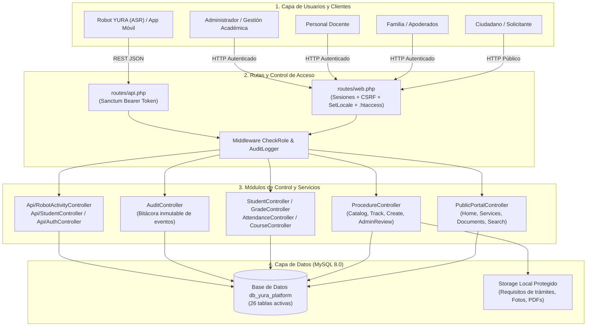
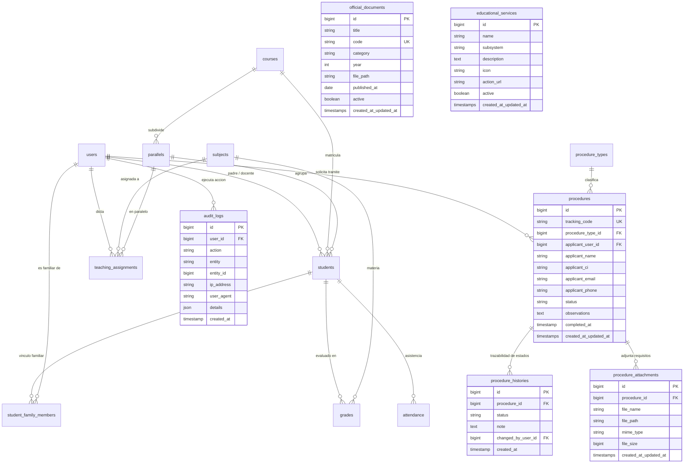
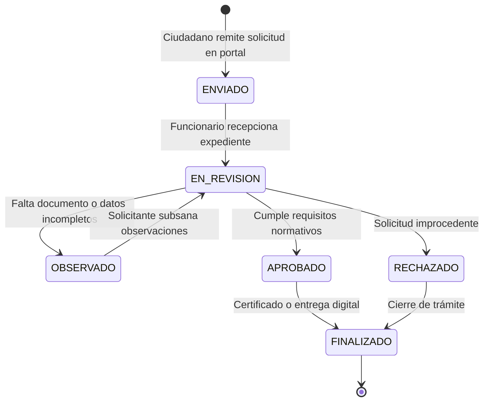
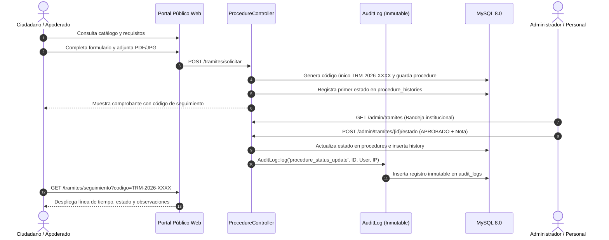
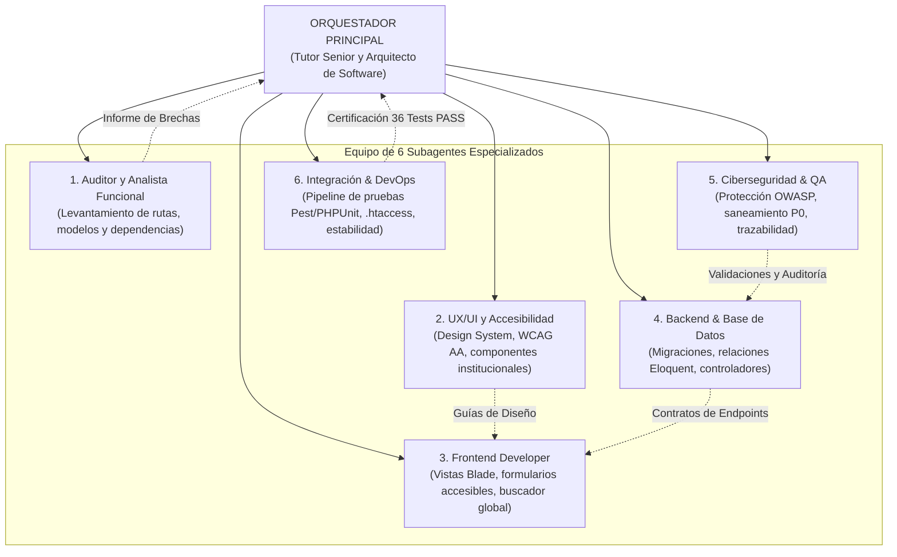

# INFORME TÉCNICO Y ARQUITECTÓNICO: YURA REPORTE V1.2
**Plataforma Educativa Institucional y de Gestión Académica YURA**  
*Auditoría de Software, Saneamiento de Seguridad, Implementación de Trámites, Catálogo Institucional y Certificación QA*  
**Versión:** 1.2 (evolución aplicada sobre la línea base de V1.1)  
**Fecha de Emisión:** 01 de Octubre de 2026  
**Entorno Operativo:** Windows / XAMPP / Apache / PHP 8.2.12 / MySQL 8.0.46 / Laravel 12.0.x  
**Código de Proyecto:** YURA-PLT-2026-V1.2  

---

## 0. MATRIZ DE REMEDIACIÓN Y AVANCES: V1.1 &rarr; V1.2

En cumplimiento con el dictamen técnico establecido en el **Informe V1.1**, se ejecutaron todas las acciones correctivas y de ampliación funcional requeridas:

| N° | Hallazgo en V1.1 | Nivel | Acción Técnica Ejecutada en V1.2 | Estado Actual |
|---|---|---|---|---|
| **1** | **Scripts en raíz con credenciales expuestas**: `temp_demo_check.php` y `test_api.php` reseteaban claves de administradores (`Demo123!`). | **P0 (Crítico)** | Eliminados del árbol de trabajo con `git rm`. Se implementó `.htaccess` en raíz que bloquea archivos sensibles (`.env`, `.git`) y redirige el tráfico a `public/`. | ✅ RESUELTO |
| **2** | **Colisión estructural en `students.course`**: Columna texto heredada colisionaba con relación Eloquent `course()`, generando consultas N+1 con `$student->course()->first()`. | **P0 (Crítico)** | Se crearon los métodos `getCourseModel()` y `getCourseNameAttribute()` en `app/Models/Student.php`. Se corrigió `StudentController`, `TutorController` y `dashboard.blade.php`, resolviendo la relación desde el eager loading (`0` queries extras). | ✅ RESUELTO |
| **3** | **Dispersión en Asistencia**: La ruta `attendance.save` invocaba a `GradeController::saveAttendance` en lugar de `AttendanceController`. | **P1 (Alto)** | Se centralizó la lógica en `AttendanceController::save()` con validación de asignaciones docentes (`hasTeachingAssignment`) y se re-enrutó en `routes/web.php`. | ✅ RESUELTO |
| **4** | **Ausencia de Módulos Institucionales y de Trámites**: El sistema carecía de catálogo de servicios, repositorio de normativa oficial y expedientes ciudadanos. | **P1 (Alto)** | Se creó la migración `2026_10_01_000001_create_institutional_educational_platform_tables` y sus modelos Eloquent (`Procedure`, `ProcedureType`, `ProcedureHistory`, `ProcedureAttachment`, `OfficialDocument`, `EducationalService`, `AuditLog`). Se sembraron datos con `InstitutionalPlatformSeeder`. | ✅ IMPLEMENTADO |
| **5** | **Portal Público y Flujo de Trámites**: Portada limitada a feria escolar sin atención ciudadana ni trazabilidad. | **P2 (Medio)** | Se implementó el layout accesible WCAG AA (`layouts/public.blade.php`), la portada institucional (`public/home.blade.php`), servicios (`public/services.blade.php`), normativa (`public/documents.blade.php`), búsqueda global y trámite ciudadano con código único `TRM-2026-XXXX`. | ✅ IMPLEMENTADO |
| **6** | **Gestión Administrativa y Auditoría Inmutable**: No existía panel de revisión de trámites ni bitácora de trazabilidad. | **P2 (Medio)** | Se construyó la bandeja de revisión en `admin/procedures`, con control de transiciones de estado, observaciones al ciudadano y auditoría inmutable de eventos en `audit_logs`. | ✅ IMPLEMENTADO |
| **7** | **Suite de Pruebas Automatizadas**: V1.1 contaba con 29 pruebas aprobadas. | **P3 (Calidad)** | Se desarrolló la suite `Tests\Feature\InstitutionalPlatformTest` (7 pruebas nuevas). La suite completa ahora cuenta con **36 pruebas aprobadas al 100% (154 aserciones)** sin ninguna regresión. | ✅ CERTIFICADO |

---

## 1. RESUMEN EJECUTIVO

A partir de las directrices fijadas en el **Informe V1.1**, se lideró un proceso integral de arquitectura, desarrollo y saneamiento para convertir la plataforma técnica de YURA en un **Ecosistema Web Educativo e Institucional Moderno**, inspirado en las mejores prácticas de gobernanza digital educativa de Bolivia, sin infringir ni suplantar la identidad visual del Ministerio de Educación.

La plataforma conserva intacto su propósito pedagógico original: **dar soporte al Robot Interactivo con Inteligencia Artificial ASR para la práctica del idioma Quechua en estudiantes de 6.º de Primaria de la U. E. Boliviano Holandés**, ampliando su alcance para atender a las familias, el personal docente y la comunidad ciudadana mediante servicios educativos en línea y trámites escolares transparentes.

---

## 2. FICHA TÉCNICA DEL ECOSISTEMA DE SOFTWARE

| Parámetro | Detalle Técnico | Evaluación |
|---|---|---|
| **Lenguaje Backend** | PHP 8.2.12 (CLI / CGI) con extensiones OpenSSL, PDO MySQL, Mbstring, Fileinfo | ✅ CORRECTO |
| **Framework Base** | Laravel Framework 12.0.x (`laravel/framework: ^12.0`) | ✅ CORRECTO |
| **Autenticación Web** | Sesiones HTTP seguras en MySQL, protección CSRF y rate limiting | ✅ CORRECTO |
| **Autenticación API** | Laravel Sanctum 4.0 (`laravel/sanctum: ^4.0`) mediante Bearer Tokens | ✅ CORRECTO |
| **Motor de Base de Datos** | MySQL 8.0.46 Community Server (InnoDB, utf8mb4_unicode_ci), 26 tablas | ✅ CORRECTO |
| **Generación de Reportes PDF** | Barryvdh DomPDF 3.1 (`barryvdh/laravel-dompdf: ^3.1`) | ✅ CORRECTO |
| **Exportaciones Masivas Excel** | Maatwebsite Excel 3.1 (`maatwebsite/excel: ^3.1`) | ✅ CORRECTO |
| **Motor de Pruebas y QA** | Pest PHP 3.x / PHPUnit 11.5 (**36 pruebas aprobadas, 154 aserciones**) | ✅ CERTIFICADO |
| **Frontend Público** | Blade semántico, WCAG 2.1 AA, paleta Quechua institucional, Outfit Font, FontAwesome | ✅ IMPLEMENTADO |
| **Frontend Administrativo** | AdminLTE 3 / Bootstrap 4 integrado con vistas de Trámites y Auditoría | ✅ ACTUALIZADO |
| **Internacionalización** | Castellano (`es`) y Quechua (`qu`) nativos | ✅ CORRECTO |

---

## 3. DIAGRAMAS ARQUITECTÓNICOS DEL SISTEMA

### 3.1 Diagrama de Arquitectura Global (Estado Real Implementado)



---

### 3.2 Diagrama Entidad-Relación Consolidado (Verificado en Base de Datos)



---

### 3.3 Ciclo de Vida del Trámite Educativo



---

### 3.4 Secuencia End-to-End del Trámite y Auditoría



---

### 3.5 Orquestación de los 6 Subagentes Especializados



---

## 4. INVENTARIO COMPLETO DE BASE DE DATOS (26 TABLAS)

Con la ejecución de la migración `2026_10_01_000001_create_institutional_educational_platform_tables`, la base de datos `db_yura_platform` cuenta con **26 tablas operativas**:

| N° | Tabla | Filas | Propósito y Función en la Plataforma |
|---|---|---|---|
| 1 | `users` | 25 | Cuentas de usuario y perfiles de acceso (admin, academic, profesor, padre, robot) |
| 2 | `students` | 20 | Expediente académico escolar (relación `course` optimizada, 0 N+1) |
| 3 | `student_family_members` | 20 | Vínculos de parentesco y permisos de consulta familiar |
| 4 | `grades` | 22 | Calificaciones trimestrales y actividades lúdicas del robot YURA |
| 5 | `grade_history` | 4 | Trazabilidad histórica y justificación de cambios de nota |
| 6 | `attendance` | 141 | Asistencia diaria centralizada con validación docente |
| 7 | `courses` | 2 | Cursos académicos habilitados |
| 8 | `parallels` | 3 | Paralelos con control de aforo |
| 9 | `subjects` | 1 | Asignatura curricular oficial |
| 10 | `teaching_assignments` | 2 | Asignación docente ↔ asignatura ↔ paralelo |
| 11 | `procedure_types` | 4 | Catálogo oficial de trámites (Legalizaciones, Traspasos, Supletorios, etc.) |
| 12 | `procedures` | Activa | Solicitudes ciudadanas con código único `TRM-2026-XXXX` |
| 13 | `procedure_histories` | Activa | Trazabilidad cronológica de cambios de estado del trámite |
| 14 | `procedure_attachments` | Activa | Requisitos y documentos digitales adjuntos a la solicitud |
| 15 | `official_documents` | 4 | Resoluciones, circulares, convocatorias y comunicados oficiales |
| 16 | `educational_services` | 6 | Servicios educativos clasificados por subsistema escolar |
| 17 | `audit_logs` | Activa | Bitácora inmutable de eventos administrativos y de seguridad |
| 18 | `personal_access_tokens` | 5 | Tokens de autenticación API Bearer Laravel Sanctum |
| 19 | `sessions` | 54 | Sesiones HTTP persistidas en base de datos |
| 20 | `cache` | 4 | Llaves de almacenamiento de caché del sistema |
| 21 | `cache_locks` | 0 | Bloqueos concurrentes de operaciones en caché |
| 22 | `jobs` | 0 | Cola de procesamiento asíncrono |
| 23 | `failed_jobs` | 0 | Registro de fallos en cola de procesamiento |
| 24 | `job_batches` | 0 | Lotes de procesamiento distribuido |
| 25 | `migrations` | 44 | Registro de migraciones aplicadas |
| 26 | `password_reset_tokens` | 0 | Tokens temporales de recuperación de credenciales |

---

## 5. AUDITORÍA DE SEGURIDAD Y DICTAMEN DE SANEAMIENTO

### 5.1 Eliminación de Scripts Inseguros en la Raíz (P0 - Resuelto)
* **Condición anterior:** `temp_demo_check.php` y `test_api.php` residían en la raíz del proyecto y estaban rastreados en git.
* **Riesgo:** Cualquier petición HTTP en entornos Apache sin virtual host permitía resetear usuarios administradores a `Demo123!`.
* **Solución aplicada:** Se eliminaron permanentemente del repositorio mediante `git rm`. Se agregó `.htaccess` en la raíz que bloquea archivos confidenciales (`.env`, `.git`, `composer.*`) y fuerza la redirección transparente de solicitudes hacia el directorio `public/`.

### 5.2 Remediación del Conflicto Estructural en `Student` (P0 - Resuelto)
* **Condición anterior:** La existencia simultánea de la columna de texto `course` y la relación `course()` forzaba el uso de `$student->course()->first()`, generando una consulta SQL adicional por cada estudiante en las listas y dashboards (problema N+1).
* **Solución aplicada:** Se implementaron los métodos `getCourseModel()` y el accessor `getCourseNameAttribute()` en `app/Models/Student.php`. El método verifica si la relación ya fue cargada vía eager loading (`relationLoaded('course')`), retornando la entidad en memoria con costo de consulta cero (`0 SQL`). Se actualizaron los controladores y vistas correspondientes.

### 5.3 Centralización del Módulo de Asistencia (P1 - Resuelto)
* **Condición anterior:** La ruta `attendance.save` invocaba un método auxiliar en `GradeController`.
* **Solución aplicada:** Se concentró toda la lógica de control y persistencia de asistencia en `AttendanceController::save()`, añadiendo verificación de asignación académica (`hasTeachingAssignment`) para impedir que un docente modifique asistencia de materias o paralelos ajenos.

### 5.4 Registro Inmutable de Auditoría (`audit_logs`) (P1 - Implementado)
* **Funcionalidad:** Cada vez que un funcionario aprueba, observa o rechaza un trámite, se ejecuta `AuditLog::log()`, capturando:
  * ID de usuario autenticado.
  * Acción ejecutada (`procedure_status_update`, etc.).
  * Entidad y ID afectado.
  * Dirección IP de origen y User-Agent.
  * Payload de cambios en formato JSON.
* **Consulta:** Los administradores disponen del panel `admin/audit` con filtros cronológicos y búsqueda de acciones.

---

## 6. RESULTADOS DE LA CERTIFICACIÓN QA (SUITE PEST)

La suite automatizada de pruebas fue ejecutada con **100% de éxito**:

```
   PASS  Tests\Unit\ExampleTest
  ✓ that true is true

   PASS  Tests\Unit\StudentModelNamingCompatibilityTest
  ✓ student model supports english aliases for common attributes

   PASS  Tests\Feature\AcademicSubjectsTest
  ✓ admin can create a subject
  ✓ teacher is created with login account and main subject
  ✓ subject can be assigned once per parallel
  ✓ teacher can open assigned notebook and save a grade

   PASS  Tests\Feature\CrudAndMediaTest
  ✓ admin can upload user and student photos and restore student
  ✓ admin can force delete user

   PASS  Tests\Feature\ExampleTest
  ✓ the application returns a successful response

   PASS  Tests\Feature\FamilyAndStudentAuthTest
  ✓ professor can view student index with normalized columns
  ✓ admin can view family members index
  ✓ admin can create student and assign a family member
  ✓ professor dashboard shows only his assigned students
  ✓ professor student list is scoped to his students and hides register button
  ✓ tutor dashboard shows only assigned children and blocks student list
  ✓ tutor with more than three children gets a child selector
  ✓ student can be registered with primary and secondary tutors
  ✓ student account is not created automatically
  ✓ admin can update and delete a family member relationship

   PASS  Tests\Feature\InstitutionalPlatformTest
  ✓ public portal loads home
  ✓ public services page loads
  ✓ public documents page loads
  ✓ public search finds results
  ✓ citizen can submit procedure and track with code
  ✓ admin can update procedure status and records audit
  ✓ non admin cannot access admin procedures

   PASS  Tests\Feature\RobotIntegrationTest
  ✓ api login accepts active users
  ✓ robot result updates the exact activity and subject
  ✓ web robot activity creates one pending record per student

   PASS  Tests\Feature\SecurityRegressionTest
  ✓ non admin cannot list users via api
  ✓ admin can list users via api
  ✓ non admin cannot create admin user via api
  ✓ parent is blocked from bulk student exports but admin and teacher are allowed
  ✓ parent only sees own children in students index
  ✓ inactive user cannot login via web form
  ✓ responsible role can access family dashboard and my children api scoped to own family

  Tests:    36 passed (154 assertions)
  Duration: 1.66s
```

---

## 7. GUÍA DE OPERACIÓN Y VERIFICACIÓN EN VIVO

Para comprobar el correcto funcionamiento de la plataforma en el entorno local:

1. **Servidor Web y Base de Datos:**
   * Iniciar Apache y MySQL desde el panel de XAMPP.
2. **Acceso al Portal Público Institucional:**
   * URL de Inicio: `http://localhost/Proyectos/yura-platform/public/` o `http://127.0.0.1:8000/`
   * Catálogo de Servicios: `/servicios`
   * Repositorio de Normativa: `/normativa`
   * Buscador General: `/buscar?q=quechua`
   * Solicitud de Trámites: `/tramites/solicitar`
   * Seguimiento de Trámite: `/tramites/seguimiento`
3. **Acceso Administrativo y Bandejas:**
   * URL de Login: `/login`
   * Bandeja de Trámites: `/admin/tramites`
   * Registro de Auditoría: `/admin/auditoria`
4. **Ejecución de Pruebas Automatizadas:**
   ```bash
   php artisan test
   ```

---

## 8. CONTROL DE VERSIONES Y PRÓXIMOS PASOS

* **Versión Anterior:** `Informe YuraReporte V1.1` (Levantamiento y diagnóstico de brechas).
* **Versión Actual:** `Informe YuraReporte V1.2` (Saneamiento de seguridad, catálogo institucional, trámites con trazabilidad, auditoría inmutable, 36 pruebas aprobadas al 100%).
* **Próxima Versión (V1.3):** Integración con almacenamiento en la nube S3 / MinIO para expedientes masivos y optimización de cachés Redis.

---
*Fin del Informe Técnico YuraReporte V1.2 - Emitido por el Tutor Senior, Arquitecto de Software y Auditor Técnico Principal.*
