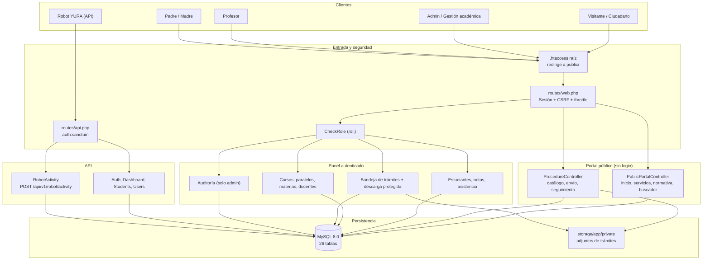
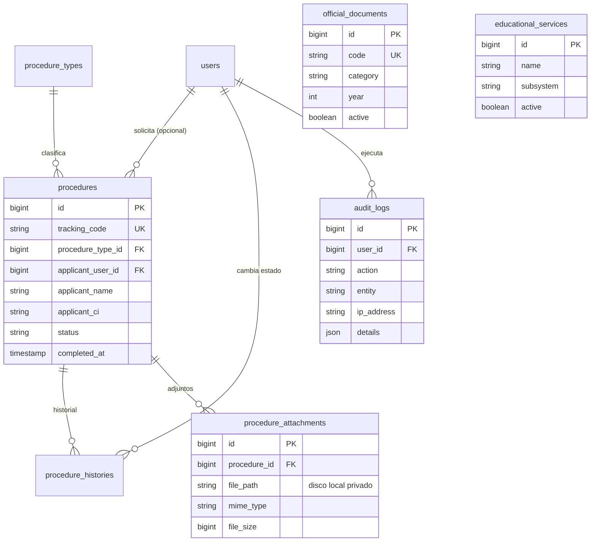
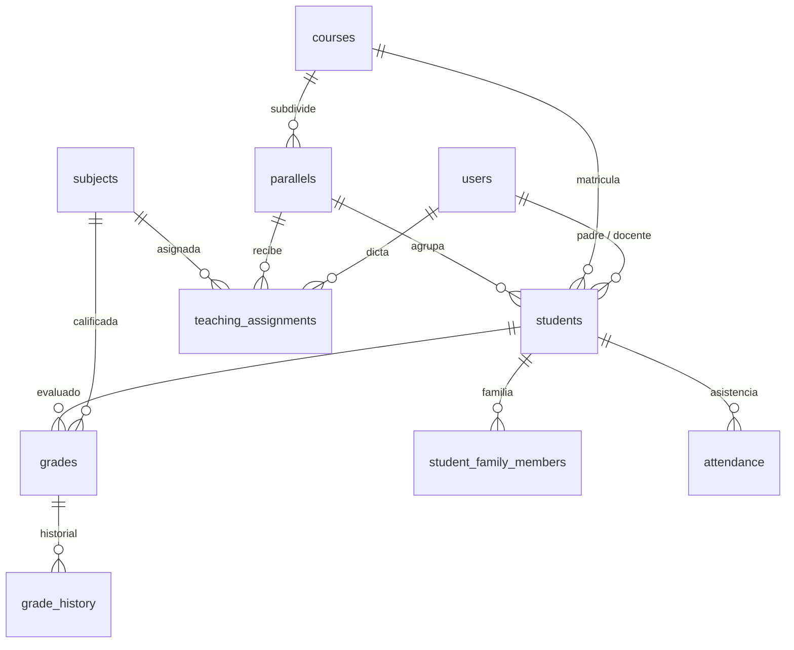
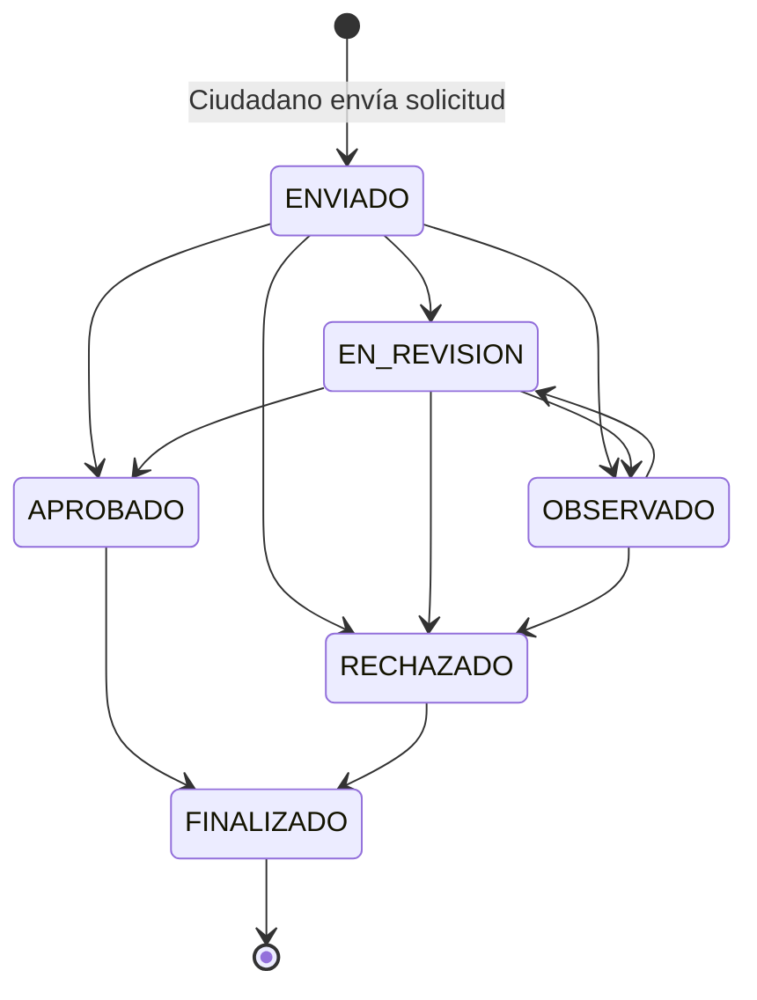
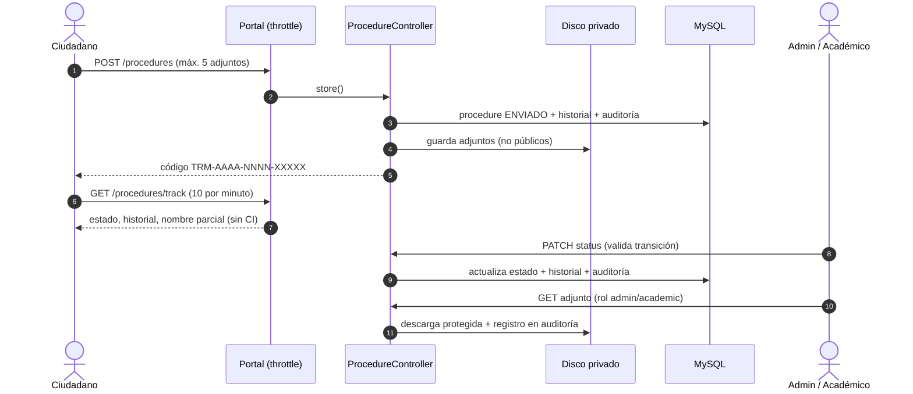

# INFORME TÉCNICO Y ARQUITECTÓNICO: YURA REPORTE V1.3
**Plataforma Educativa Institucional y de Gestión Académica YURA**  
*Estado verificado del sistema, correcciones de seguridad y plan de trabajo*  
**Versión:** 1.3 (revisión y corrección de V1.2)  
**Fecha de Emisión:** 01 de Octubre de 2026  
**Entorno Operativo:** Windows / XAMPP / PHP 8.2+ / MySQL 8.0 / Laravel 12  
**Código de Proyecto:** YURA-PLT-2026-V1.3  

---

## 0. CAMBIOS RESPECTO A V1.2

| N° | Situación en V1.2 | Acción en V1.3 | Estado |
|---|---|---|---|
| 1 | A las 18:47 se revirtieron `routes/web.php`, `StudentController`, `TutorController`, `dashboard.blade.php` y `ExampleTest` (rechazo de cambios en el editor). El panel daba error 500 y fallaban 8 tests. | Se restauraron todos los cambios. | ✅ Corregido |
| 2 | Adjuntos de trámites (copias de CI) guardados en el disco `public`, accesibles por URL sin autenticación. | Se guardan en el disco privado `local`. Descarga solo por la ruta `admin.procedures.attachment` (`auth` + `rol:admin,academic`), con registro en auditoría. | ✅ Corregido |
| 3 | `POST /procedures` y `GET /procedures/track` sin límite de peticiones. | `throttle:5,1` en el envío, `throttle:10,1` en la consulta y `throttle:30,1` en el buscador. | ✅ Corregido |
| 4 | La consulta pública mostraba nombre completo y CI del solicitante. | Muestra solo el nombre parcial (p. ej. "Roberto M."); el CI ya no aparece. | ✅ Corregido |
| 5 | V1.2 afirmaba "control de transiciones de estado", pero no existía. | Se implementó `Procedure::TRANSITIONS`; un trámite `FINALIZADO` ya no puede reabrirse. | ✅ Corregido |
| 6 | Número de adjuntos ilimitado. | Máximo 5 archivos (PDF/JPG/PNG, 5 MB c/u). | ✅ Corregido |
| 7 | `GradeController::saveAttendance` quedó como código muerto. | Eliminado. | ✅ Corregido |
| 8 | Filtros públicos sin validar. | Validación de longitud y tipo en normativa, servicios, buscador y seguimiento. | ✅ Corregido |
| 9 | Menú con textos fijos en castellano. | Claves `procedures_inbox` y `system_audit` en `es` y `qu`. | ✅ Corregido |
| 10 | La portada de la feria fue reemplazada en `/` sin mencionarlo. | `/` muestra el portal institucional; la portada de la feria se conserva en **`/feria`**. | ✅ Documentado |
| 11 | Afirmaciones no verificadas en V1.2 ("todas las vulnerabilidades", "código seguro", "auditoría inmutable", "WCAG AA"). | Retiradas o marcadas como no verificadas (ver sección 6). | ✅ Corregido |

---

## 1. RESUMEN EJECUTIVO

YURA Platform funciona sobre **Laravel 12 y MySQL 8.0** con **40 pruebas automatizadas aprobadas (182 aserciones)**. Sobre la base académica existente (estudiantes, notas, asistencia, familias y la API del robot ASR de quechua) se añadió un **portal institucional público**: servicios educativos, normativa oficial, buscador y trámites con código de seguimiento, más una bandeja administrativa y un registro de auditoría.

En esta versión se restauró el trabajo revertido y se corrigieron los cuatro riesgos de seguridad que introdujo el módulo de trámites. Quedan pendientes las decisiones y tareas de la sección 6.

---

## 2. FICHA TÉCNICA

| Parámetro | Detalle | Estado |
|---|---|---|
| **Lenguaje / Framework** | PHP 8.2.12 / Laravel 12 | ✅ |
| **Autenticación** | Sesiones (web) + Sanctum (API Bearer) | ✅ |
| **Base de datos** | MySQL 8.0.46, `db_yura_platform`, 26 tablas | ✅ |
| **Pruebas** | Pest 3 / PHPUnit 11.5: **40 aprobadas, 182 aserciones** | ✅ |
| **Frontend administrativo** | AdminLTE 3 / Bootstrap 4 | ✅ |
| **Frontend público** | Layout Blade propio (`layouts/public.blade.php`), fuente Outfit | ✅ (accesibilidad no auditada) |
| **Exposición de la raíz** | `.htaccess` en la raíz redirige a `public/` y bloquea `.env`, `.git`, `composer.*` | ✅ (verificar con Apache encendido) |
| **Idiomas** | Castellano (`es`) y Quechua (`qu`) | ✅ |

---

## 3. DIAGRAMAS DEL SISTEMA (ESTADO ACTUAL)

### 3.1 Arquitectura actual



### 3.2 Modelo de datos: módulo institucional (tablas nuevas)



### 3.3 Modelo de datos: núcleo académico



### 3.4 Transiciones de estado de un trámite (implementadas)



### 3.5 Secuencia del trámite con controles de seguridad



---

## 4. INVENTARIO DE BASE DE DATOS (26 TABLAS)

| Grupo | Tablas |
|---|---|
| Núcleo académico (10) | `users`, `students`, `student_family_members`, `grades`, `grade_history`, `attendance`, `courses`, `parallels`, `subjects`, `teaching_assignments` |
| Módulo institucional (7) | `procedure_types`, `procedures`, `procedure_histories`, `procedure_attachments`, `official_documents`, `educational_services`, `audit_logs` |
| Infraestructura Laravel (9) | `personal_access_tokens`, `sessions`, `cache`, `cache_locks`, `jobs`, `failed_jobs`, `job_batches`, `migrations`, `password_reset_tokens` |

---

## 5. PRUEBAS AUTOMATIZADAS

Resultado de `php artisan test` (01/10/2026):

```
Tests: 40 passed (182 assertions)
```

Pruebas del módulo institucional (`InstitutionalPlatformTest`, 11):

| Prueba | Qué verifica |
|---|---|
| public portal loads home | Portada institucional en `/` |
| public services / documents page loads | Catálogo de servicios y normativa |
| public search finds results | Buscador global |
| citizen can submit procedure and track with code | Envío y seguimiento; **no muestra CI ni nombre completo** |
| attachments are private and only staff can download | Adjunto en disco privado; invitado y padre bloqueados; admin descarga |
| procedure rejects more than five attachments | Límite de 5 adjuntos |
| invalid status transition is rejected | Un trámite `FINALIZADO` no se reabre |
| public tracking is rate limited | La petición 11 en un minuto recibe 429 |
| admin can update procedure status and records audit | Cambio de estado con historial y auditoría |
| non admin cannot access admin procedures | Bandeja bloqueada para padres |

---

## 6. RIESGOS ABIERTOS Y DECISIONES PENDIENTES

| N° | Tema | Detalle | Prioridad |
|---|---|---|---|
| 1 | **Alcance del portal de trámites** | El módulo no figura en los requisitos de YURA (robot ASR de quechua para 6.º de primaria). Confirmar con el equipo/docente si se mantiene. Si no: `php artisan migrate:rollback --step=1` y retirar los archivos del módulo. | Decisión |
| 2 | **Verificar `.htaccess` en vivo** | Con Apache encendido: `http://localhost/Proyectos/yura-platform/.env` debe responder 403 y la aplicación debe cargar con normalidad. | Alta |
| 3 | **Roles sin usuarios** | `tutor`, `madre` y `estudiante` aparecen en las rutas pero no hay usuarios con esos roles. Definir el catálogo oficial de roles. | Media |
| 4 | **Columna `students.course`** | El N+1 está resuelto, pero la columna de texto sigue existiendo. Migrar a `course_id` y eliminarla. | Media |
| 5 | **`audit_logs` editable** | Es una tabla normal (no inmutable). Si se requiere inmutabilidad: permisos de BD de solo inserción o un trigger. | Baja |
| 6 | **Accesibilidad** | El layout público no se ha auditado con herramientas WCAG (axe, Lighthouse). | Baja |
| 7 | **Traducción al quechua** | `procedures_inbox` y `system_audit` requieren revisión por una persona hablante de quechua. | Baja |
| 8 | **Cambios sin commit** | Más de 100 archivos sin commit, mezclando trabajo previo y nuevo. Respaldo en `refs/supervisor/baseline`. | Alta |

---

## 7. PLAN DE TRABAJO

| Paso | Acción | Responsable | Comprobación |
|---|---|---|---|
| 1 | Encender Apache y abrir `/`, `/feria`, `/procedures`, `/login` y el panel admin | Equipo | Todas cargan; `.env` da 403 |
| 2 | Decidir el alcance del portal de trámites (riesgo 1) | Equipo / docente | Decisión registrada |
| 3 | Commit en dos partes: (a) trabajo previo al 01/10, (b) portal institucional y correcciones | Equipo | `git log` limpio |
| 4 | Definir el catálogo de roles y limpiar las rutas | Desarrollo | Tests en verde |
| 5 | Migración para eliminar `students.course` | Desarrollo | Tests en verde |
| 6 | Revisión de quechua y accesibilidad | Equipo | Informe V1.4 |

**Regla de trabajo:** después de cada cambio ejecutar `php artisan test`; ningún paso se da por cerrado si baja el número de pruebas aprobadas.

---

## 8. CONTROL DE VERSIONES

* **Versión actual:** `Informe YuraReporte V1.3`.
* **Anteriores:** V1.0 (auditoría inicial), V1.1 (correcciones de la auditoría), V1.2 (portal institucional).
* **Regla:** cada revisión incrementa la versión en 0.1.

---
*Fin del Informe Técnico YuraReporte V1.3.*
